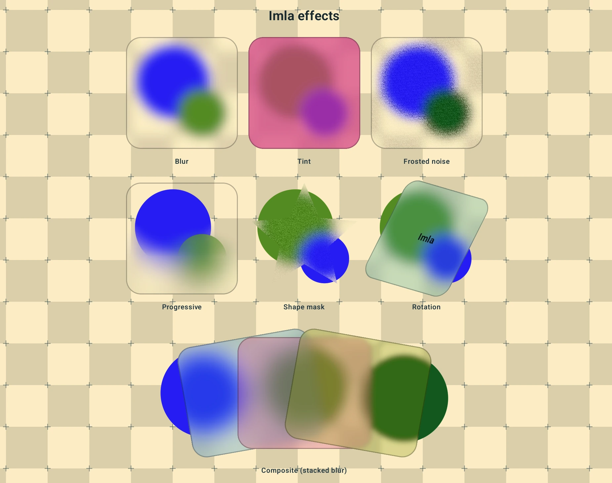
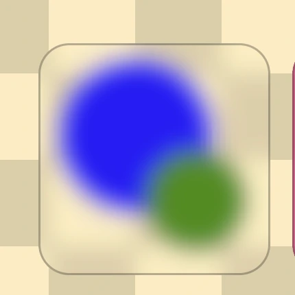
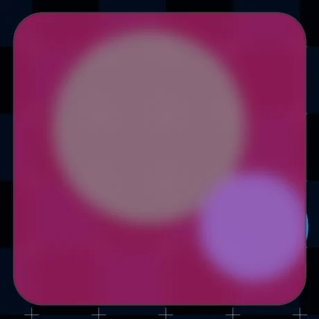
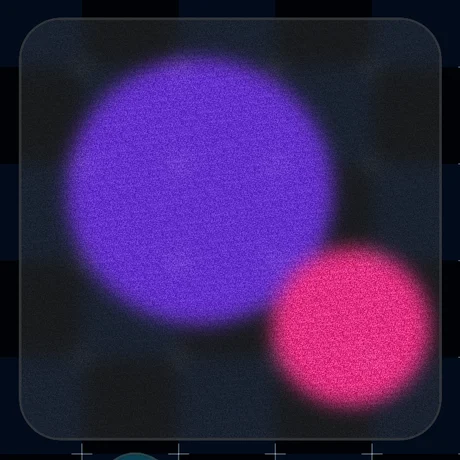
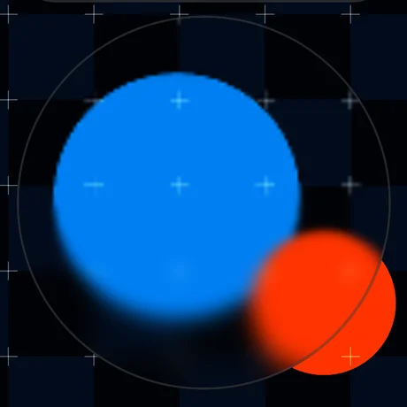
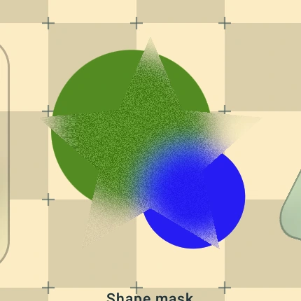
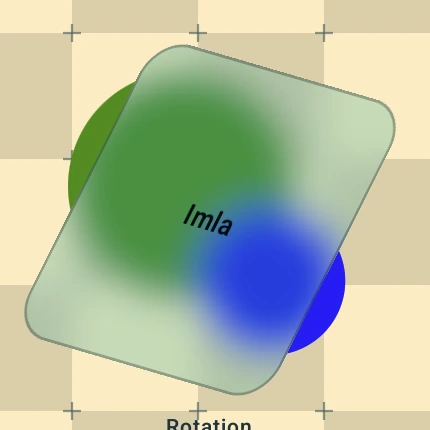
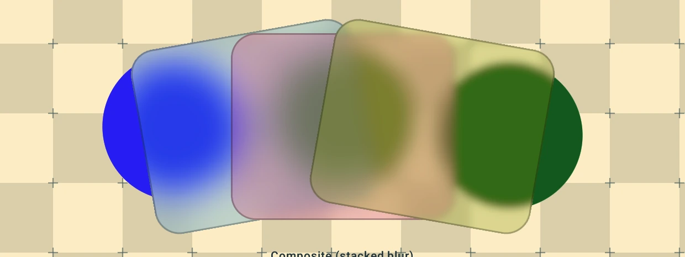
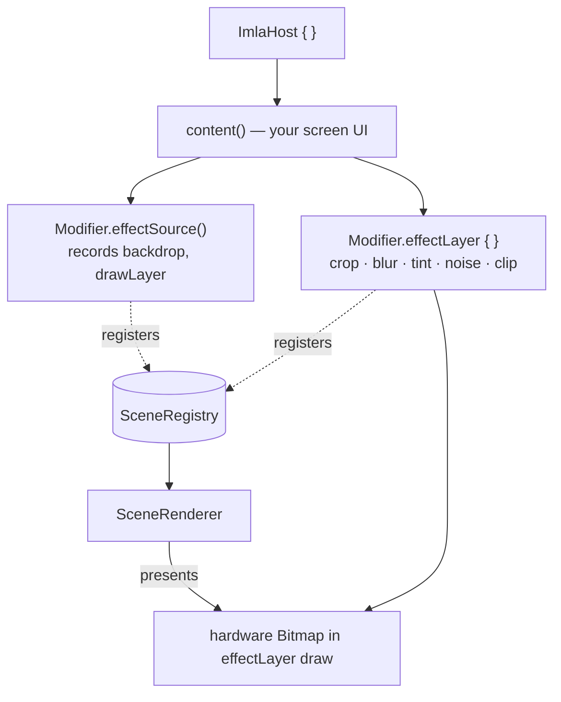
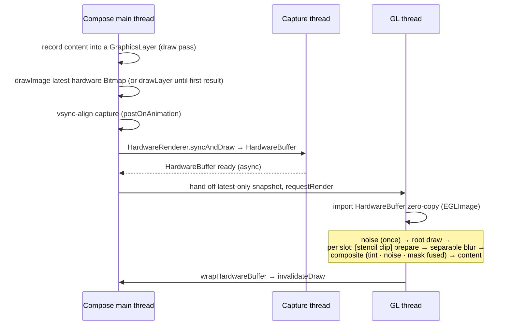

# Imla - (Experimental) GPU-Accelerated Blurring for Android Jetpack Compose UI

> [!CAUTION]
> **This is not a library, and it is not production-ready.** Imla is a for-fun
> experiment exploring an alternative Jetpack Compose rendering approach — capturing
> the Compose root and effect layers through OpenGL and HardwareBuffers. Don't ship it.

## Description

Imla (Ukrainian for "Haze", pronounced [ˈimlɑ] (eem-lah)) is an experimental
GPU-accelerated backdrop blur for Jetpack Compose. It captures the Compose root
into a `HardwareBuffer`, imports it zero-copy as an OpenGL ES texture, and runs
blur, tint, noise, clip, and progressive-mask passes that sample that shared
backdrop. Targets Android 6 (API 23) and up.

## Features

- **Backdrop blur** — separable Gaussian, adjustable radius, gamma-correct
  (blurred in linear light to avoid dark seams).
- **Progressive blur** — a brush mask drives blur strength per pixel (crisp →
  blurred gradients).
- **Shape masking** — clip a layer to any `Shape` outline.
- **Tinting** — color composited over the blurred backdrop.
- **Noise blend** — frosted-glass grain, lightness-driven (strongest in
  mid-tones, eased off in shadows and highlights).
- **Composite rendering** — stack independent effect layers; each samples the
  shared backdrop and composites by z-order.
- **Rotation-correct** — 3-axis `graphicsLayer` rotation stays aligned with the
  sampled backdrop.
- **Hardware-accelerated** — HardwareBuffer capture and zero-copy GL import,
  on-GPU end-to-end.
- Supports Android 6 (API 23) onwards.

## Showcase

Each tile below is a single `Modifier.effectLayer { … }` sampling one shared
backdrop — rendered on a calibration grid so the effect is easy to read.

<p align="center">
  
</p>

<table>
  <tr>
    <td align="center" width="33%"><br/><b>Blur</b><br/><code>backdropBlur(radius)</code></td>
    <td align="center" width="33%"><br/><b>Tint</b><br/><code>tint(color)</code></td>
    <td align="center" width="33%"><br/><b>Frosted noise</b><br/><code>noise(alpha)</code></td>
  </tr>
  <tr>
    <td align="center"><br/><b>Progressive blur</b><br/>crisp top → blurred bottom<br/><code>backdropBlur(radius, progressiveMask)</code></td>
    <td align="center"><br/><b>Shape mask</b><br/>arbitrary clip outline<br/><code>clip(shape)</code></td>
    <td align="center"><br/><b>Rotation</b><br/>3-axis tilt stays aligned<br/><code>graphicsLayer { rotationX/Y/Z }</code></td>
  </tr>
  <tr>
    <td align="center" colspan="3"><br/><b>Composite</b><br/>stack independent blur layers — each effect samples the shared backdrop and composites by z-order</td>
  </tr>
</table>

## Usage

Wrap a screen — or any region — in `ImlaHost`, then declare blur regions with the
`effectSource` / `effectLayer` modifiers. No renderer or OpenGL objects are passed
to children; they register through the host.

```kotlin
ImlaHost {
    Box(Modifier.fillMaxSize()) {
        FeedContent(Modifier.fillMaxSize().effectSource())

        TopBar(
            modifier = Modifier.effectLayer {
                backdropBlur(radius = 12.dp)
                tint(Color.White.copy(alpha = 0.1f))
                noise(alpha = 0.15f)
                clip(RoundedCornerShape(16.dp))
            }
        )
    }
}
```

Public API:
[`ImlaHost`](imla/src/main/java/dev/serhiiyaremych/imla/ImlaHost.kt#L58),
[`Modifier.effectSource()`](imla/src/main/java/dev/serhiiyaremych/imla/EffectLayer.kt#L24),
[`Modifier.effectLayer { ... }`](imla/src/main/java/dev/serhiiyaremych/imla/EffectLayer.kt#L40),
[`EffectLayerScope`](imla/src/main/java/dev/serhiiyaremych/imla/EffectLayer.kt#L59), and
[`EffectLayerBoundsProvider`](imla/src/main/java/dev/serhiiyaremych/imla/EffectLayer.kt#L45).

## Architecture

`ImlaHost` provides a renderer and layer registry. On API 29+ `Modifier.effectSource()`
records backdrop content and draws it through HWUI. Each sibling `effectLayer`
crop-captures that source in its own bounds, the renderer composites effects into a
layer-sized hardware `Bitmap`, and the layer `drawImage`s it. There is no host
`SurfaceView`. On API 23–28 the source and layers draw recorded content with no
effects.



- **API 29+** — GL composites each layer offscreen into a `HardwareBuffer`, wraps
  it as a hardware `Bitmap`, and `effectLayer` `drawImage`s it (Y-flipped to
  match HWUI).
- **API 23–28** — `wrapHardwareBuffer` does not exist; the source and layers draw
  their recorded `GraphicsLayer`s with no GL present.

Each effect layer captures only its bounds from the source `GraphicsLayer`, not
the full window.

### Per-frame flow



### HardwareBuffers end-to-end

The Compose source is recorded into a `GraphicsLayer`. Each effect layer
crop-captures that layer in its own bounds into a small `HardwareBuffer` (a
`RenderNode` rendered single-buffered off the main thread). Capture lives in
[`SingleBufferRenderer`](imla/src/main/java/dev/serhiiyaremych/imla/internal/capture/SingleBufferRenderer.kt);
the buffer is leased to the GL thread via
[`BufferLease`](imla/src/main/java/dev/serhiiyaremych/imla/internal/capture/BufferLease.kt).

The GL thread imports it **zero-copy** with `eglCreateImageFromHardwareBuffer` +
`glEGLImageTargetTexture2DOES` — no `glReadPixels` round-trip — in
[`OpenGLHardwareBufferTexture2D`](imla/src/main/java/dev/serhiiyaremych/imla/internal/render/opengl/OpenGLHardwareBufferTexture2D.kt),
driven by
[`CapturedFrameImporter`](imla/src/main/java/dev/serhiiyaremych/imla/internal/render/gl/CapturedFrameImporter.kt).

On API 29+ the finished `HardwareBuffer` is wrapped as a hardware `Bitmap` (see
[`ScenePresenter`](imla/src/main/java/dev/serhiiyaremych/imla/internal/render/gl/pipeline/ScenePresenter.kt)
and the buffer ring
[`SceneHwBufferRing`](imla/src/main/java/dev/serhiiyaremych/imla/internal/render/gl/pipeline/SceneHwBufferRing.kt))
and drawn in the effect layer. Pixels stay in GPU/shared memory across capture →
effects → present. This path is the main thing being experimented with here, and
is still being tuned.

## Rendering Abstraction

The OpenGL abstractions are reused from a sister experiment,
[desugar-64/android-opengl-renderer](https://github.com/desugar-64/android-opengl-renderer) —
a playground for learning graphics and OpenGL, with helpers for setting up GL data
and calls.

The renderer is fully dynamic: it pushes vertex data every frame. Flexible, but it
adds overhead — a future optimization target.

## Performance notes

- The separable Gaussian blur pass is the dominant GPU cost; it scales with the
  blur radius and the on-screen area being blurred.
- Per-frame cost is driven mostly by render-pass / FBO switches rather than the
  blur math itself, so timing varies by scene.

## Known issues and limitations

- **Expect bugs and untested edge cases.** This is a for-fun experiment, not a
  hardened library — it has rough edges and unhandled cases. In particular, it
  has not been tested hosting content that itself contains other `SurfaceView`s
  (video players, maps, camera previews, nested Imla hosts); surface-compositing
  scenarios like these may misbehave.
- **HardwareBuffer capture is not always the fastest path.** Across the 4 devices
  I tested on, the hardware-rendering capture path (`RenderNode` →
  `HardwareBuffer` → zero-copy GL import) is fast on 3. On the 4th, a low-end
  budget Android 13 tablet, it runs slower than capturing the UI into an external
  texture. The cause is not yet pinned down.
- **No atlas grouping yet.** Effect layers render as separate draws/passes rather
  than batched into a shared atlas. It's the main remaining GL-side optimization,
  deferred because it has to integrate with the bucketed capture buffers used for
  resizable content.
- **Dynamic per-frame vertex push.** The renderer uploads vertex data every frame
  (see [Rendering Abstraction](#rendering-abstraction)) — flexible, but more
  overhead than a static/instanced path.
- **Convoluted internal architecture.** The code grew through iteration and is
  more tangled than it needs to be — capture/import/present spread across many
  small types, with seams left over from past experiments. It works, but expect
  rough edges.

## Roadmap

- [x] Present each `effectLayer` as a layer-sized hardware `Bitmap` (API 29+;
  no host SurfaceView); `effectSource` draws through HWUI;
- [x] Capture and draw child content as GL textures;
- [x] Validate rotated slot geometry and root-space backdrop sampling;
- [x] Real separable Gaussian blur passes;
- [x] Progressive masks, stencil clips, tint, noise, and cumulative backdrop sampling;
- [ ] Atlas grouping for effect layers (needs integration with the bucketed
  capture buffers).

### To explore

- **Pre-29 effect present without a SurfaceView.** `wrapHardwareBuffer` is API
  29+; older APIs currently passthrough-draw with no effects. Options: software
  `Bitmap` copy, or raise `minSdk`.
- **Compute-shader effect path.** Run the separable blur as a GLES 3.1 compute
  shader instead of fragment passes into FBOs, skipping rasterization and some FBO
  ping-pong. Open questions: faster on mobile GPUs? compute-support / min-API
  floor?

## Contributing

This project is open to suggestions and contributions. Feel free to open issues
or submit pull requests on GitHub.

## License

This project is licensed under the MIT License. See the [LICENSE](LICENSE) file for details.

## Development Updates

For project development updates and history, refer
to [this Twitter thread](https://x.com/desugar_64/status/1787633739117277669).
